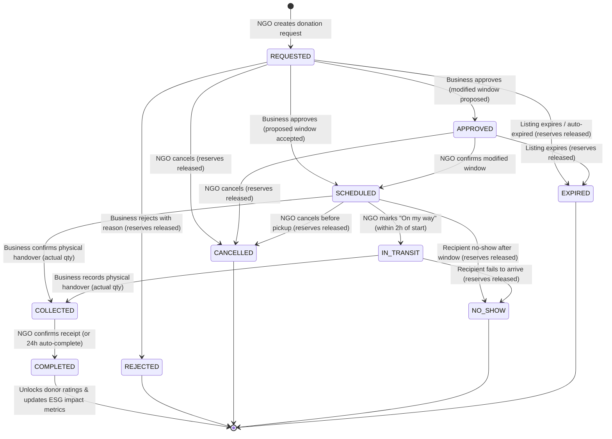

# SurplusSync : Enterprise Surplus Food Logistics & Waste Prevention

SurplusSync is an enterprise food surplus redistribution and inventory conservation platform built for hotels, restaurants, supermarket chains, and food redistribution NGO networks. It implements strict First-Expired-First-Out (FEFO) batch tracking, automated spoilage horizon alerts, barcode scanning, CSV manifest ingestion, background task processing, and secure logistics claiming workflows.

---

## Architecture Overview

- **Backend**: Django 6.1 + Django REST Framework (DRF) + SimpleJWT (`/api/v1/`) + django-q2
- **Background Tasks & Scheduling**: `django-q2` using the PostgreSQL ORM broker (`django_q_ormq`). **No Redis or Celery**.
- **Frontend**: React 19 + Vite + TypeScript + Tailwind CSS v4 + TanStack Query
- **Design System**: Dark-first SaaS aesthetic (CSS custom properties tokens in `src/tokens.css`, Inter tabular numerals, Lucide icons, Recharts)
- **Data Modes**:
  - **Live Mode (`VITE_DATA_MODE=live`)**: Directly interacts with the Django REST API at `http://127.0.0.1:8000/api/v1/`. Strict JWT bearer token authentication, no persona switcher, no demo controls. Role and organization type come exclusively from `GET /accounts/me/`.
  - **Demo Mode (`VITE_DATA_MODE=demo`)**: Autonomous in-browser simulation engine with FEFO stock deduction, interactive virtual clock, persona switcher (Business vs NGO vs Unverified NGO), async CSV import simulation, and zero backend dependency.

> [!NOTE]
> **Platform Amendment Notice**:
> - **Leaderboard Feature Removal**: The competitive Leaderboard feature has been completely removed across the entire platform (backend models, database schema migrations, REST endpoints, serializers, frontend navigation, and documentation) to focus on mission-driven, cooperative food rescue rather than gamified ranking.
> - **Dedicated Home Experience & Routing Rules**:
>   - **`"/"` (Public Landing Page)**: Public landing page for unauthenticated visitors (`PublicHomePage`), highlighting key impact statistics from `GET /api/v1/home/public/`, 3-step workflow guides, platform features, and accessible FAQs. Automatically redirects authenticated sessions to `"/home"`.
>   - **`"/home"` (Authenticated Home Cockpit)**: Role-tailored operational home cockpit for logged-in users (`AuthenticatedHomePage`), providing welcome greetings with verification badges, urgent action cards with direct deep-links, role-specific quick action shortcuts, operational StatCards, onboarding checklist with progress bars, recent activity timeline, and 30-day impact metrics. Automatically redirects unauthenticated visitors to `"/"`.
>   - **`"/dashboard"` (Operational FEFO Dashboard)**: Unchanged operational dashboard providing detailed batch-level inventory metrics, FEFO turnover tracking, and stock management.

---

## Virtual Environment Location

> [!IMPORTANT]
> The Python virtual environment is located at the **repository root**:
> - Windows: `.\venv\`
> - macOS/Linux: `./venv/`
>
> *(There is **no** virtual environment inside `backend/venv`.)*

### Activate Virtual Environment

**Windows (PowerShell)**:
```powershell
.\venv\Scripts\Activate.ps1
```

**Windows (Command Prompt)**:
```cmd
venv\Scripts\activate.bat
```

**macOS / Linux**:
```bash
source venv/bin/activate
```

---

## Backend Setup (Django, DRF & Django-Q2)

### 1. Install Dependencies
From the repository root (with virtual environment active):
```bash
pip install -r backend/requirements.txt
```

### 2. Configure Environment Variables
Copy the sample environment file in `backend/`:
```bash
# Windows
copy backend\.env.example backend\.env

# macOS / Linux
cp backend/.env.example backend/.env
```

Default settings in `backend/.env`:
```ini
SECRET_KEY=change-this-to-a-secure-random-key-in-production
DEBUG=True
ALLOWED_HOSTS=localhost,127.0.0.1
USE_POSTGRES=False
CORS_ALLOW_ALL_ORIGINS=True
```
*(Set `USE_POSTGRES=False` to use SQLite locally, or `USE_POSTGRES=True` if connecting to PostgreSQL).*

### 3. Apply Database Migrations
```bash
python backend/manage.py migrate
```

### 4. Load Initial Fixtures
Load the verified standard food categories and shelf-life horizons into the database:
```bash
python backend/manage.py loaddata backend/inventory/fixtures/categories.json
```

> [!NOTE]
> Do **NOT** run any external seed script like `seed_data.py`. Standard initial data is loaded exclusively through `loaddata backend/inventory/fixtures/categories.json`, new user registrations via `/api/v1/accounts/register/`, or `createsuperuser`.

### 5. Create an Administrative Owner
```bash
python backend/manage.py createsuperuser
```

### 6. Start Django API Server
In terminal 1:
```bash
python backend/manage.py runserver 127.0.0.1:8000
```
The REST API will be accessible at `http://127.0.0.1:8000/api/v1/`.

### 7. Run Background Worker (Django-Q2 Cluster)
In terminal 2 (with virtual environment active), start the background worker cluster:
```bash
python backend/manage.py qcluster
```
The worker processes queued tasks (asynchronous CSV manifest imports, asynchronous email notifications, and scheduled batch jobs).

### 8. Initialize Periodic Background Schedules
In terminal 3 (or once during initial setup):
```bash
python backend/manage.py setup_schedules
```
This idempotently configures the daily expiry check and 15-minute marketplace cleanup schedules in the database.

### 9. Real Backend Management Commands
- **Run Backend Test Suite** (All 95 unit and integration tests):
  ```bash
  python backend/manage.py test
  ```
- **Configure Django-Q2 Schedules**:
  ```bash
  python backend/manage.py setup_schedules
  ```
- **Run Background Worker**:
  ```bash
  python backend/manage.py qcluster
  ```
- **Check Expiry Horizons & Generate Alerts Manually**:
  Evaluates active batches against their category `AlertRule` thresholds (default lookahead: 7 days) and generates critical/warning alerts:
  ```bash
  python backend/manage.py check_expiry --days 7
  ```
- **Generate POS API Key for External POS Terminals**:
  ```bash
  python backend/manage.py create_pos_key <org_id> "Terminal 1 Cash Register"
  ```

---

## Background Jobs Architecture (Django-Q2)

SurplusSync uses **django-q2** with the **ORM broker** (PostgreSQL / SQLite database queue).

```
   ┌────────────────────────────────────────────────────────┐
   │                  SurplusSync Web API                   │
   │      (Django 6.1 + Django REST Framework)              │
   └─────────────┬───────────────────────────┬──────────────┘
                 │                           │
  HTTP 202 Async │                           │ Async Email
  CSV Upload (>50)                           │ Task Enqueue
                 ▼                           ▼
   ┌────────────────────────────────────────────────────────┐
   │           Database Queue (django_q_ormq)               │
   │     • No Redis daemon       • No Celery required       │
   │     • Fully transactional   • ACID durable in Postgres │
   └─────────────────────────────┬──────────────────────────┘
                                 │
                     Pulls tasks │ Polls schedules
                                 ▼
   ┌────────────────────────────────────────────────────────┐
   │            Django-Q2 Worker (qcluster)                 │
   │  ┌──────────────────────────────────────────────────┐  │
   │  │ Async CSV Ingestion (Batching, Deduplication)    │  │
   │  ├──────────────────────────────────────────────────┤  │
   │  │ Async Email Sender (Exponential Backoff Retries) │  │
   │  ├──────────────────────────────────────────────────┤  │
   │  │ Scheduled Expiry Check (Daily 00:05 IST)         │  │
   │  ├──────────────────────────────────────────────────┤  │
   │  │ Expire Stale Listings (Every 15 minutes)         │  │
   │  └──────────────────────────────────────────────────┘  │
   └────────────────────────────────────────────────────────┘
```

### Why ORM Broker (No Redis or Celery)?
1. **Lean Infrastructure Footprint**: SurplusSync runs on PostgreSQL without requiring standalone Redis instances, cache daemons, or Celery workers.
2. **Transaction Integrity**: Background job records (`ImportJob`), tasks, and inventory transactions share the exact same database.
3. **Cross-Platform Compatibility**: Fully compatible with Windows, macOS, and Linux out-of-the-box using standard Python multiprocessing.

### Scheduled Recurring Tasks
Schedules are managed via `python backend/manage.py setup_schedules`:
1. **`daily_expiry_check`**: Runs daily at **00:05 local time (`Asia/Kolkata` IST / UTC+05:30)**.
   - Evaluates all active batches against shelf-life horizons.
   - Generates high/medium/low priority `Alert` items.
   - Compiles and sends a consolidated daily email digest to each business organization with `email_alerts_enabled=True`.
2. **`expire_stale_marketplace_listings`**: Runs **every 15 minutes**.
   - Finds active surplus marketplace listings whose batches have expired or reached zero remaining quantity.
   - Transitions their status to `EXPIRED` to prevent NGOs from reserving spoiled inventory.

> [!NOTE]
> **Timezone Configuration**: Django's global `TIME_ZONE` is `UTC`, while `Q_CLUSTER['time_zone']` is explicitly set to `Asia/Kolkata` (IST, UTC+05:30). Running at 00:05 IST corresponds to 18:35 UTC of the preceding day.

### Asynchronous CSV Manifest Ingestion
The CSV ingestion pipeline adapts dynamically based on file size:
- **$\le 50$ rows (Synchronous)**: Processed inline immediately. Returns `201 Created` with the completed `ImportJob` payload.
- **$> 50$ rows (Asynchronous)**: Enqueued to `django-q2`. Returns `202 Accepted` with `task_id` and the `ImportJob` record in `PENDING` status.
- **Progress Polling**: Clients query `GET /api/v1/inventory/import-jobs/<id>/` every 1500ms. The background worker reports progress in real-time (`processed_rows`, `total_rows`, `rows_ok`, `rows_failed`).
- **Safe Deduplication Rule**: Existing inventory is matched by `(organization, product, batch_code)`. If matched, the batch quantity is safely incremented without creating duplicate `Batch` entries or duplicate transactions.
- **Worker Downtime Alert**: If an async job remains in `PENDING` status for more than 2 minutes, `worker_may_be_down: true` is returned and a warning banner appears on the frontend prompting the operator to start `python manage.py qcluster`.

### Asynchronous Email System
- **Django 6.1 `MAILERS` Configuration**: Utilizes Django 6.1's native `MAILERS` setting in `SURPLUSSYNC/settings.py`.
- **Serializable Task Signatures**: Background tasks accept only primitive, serializable arguments (strings, lists, dicts, integers). Model instances are never passed into `async_task`.
- **Exponential Backoff**: If SMTP transmission fails, `send_email_task` retries up to 3 times with exponential backoff delays ($0.5\text{s}$, $1.0\text{s}$, $2.0\text{s}$).
- **Transactional Notifications**:
  - **Welcome Email**: Dispatched asynchronously upon new business or NGO registration.
  - **NGO Verification / Rejection**: Dispatched asynchronously when platform admins review verification tickets.
  - **Daily Expiry Digest**: Dispatched daily after the midnight FEFO expiry check (1 email per organization).
  - **Alert Opt-Out**: Respected via the `Organization.email_alerts_enabled` boolean flag.

### Troubleshooting & Windows Multiprocessing
- **Worker May Be Down Warning**: If the frontend displays *"Background worker may be down"*, ensure `python backend/manage.py qcluster` is running in a terminal.
- **Direct Fallback Command**: If the worker cluster cannot be run during local testing, you can execute the expiry check directly with:
  ```bash
  python backend/manage.py check_expiry --days 7
  ```
- **Windows Multiprocessing**: On Windows, Python uses `spawn` for multiprocessing. The `Q_CLUSTER` configuration uses `workers: 2`, `recycle: 500`, and `timeout: 120`.

---

## Frontend Setup (React + Vite)

Navigate into the `frontend/` directory:
```bash
cd frontend
```

### 1. Install Dependencies
```bash
npm install
```

### 2. Configure Environment

Copy `.env.example` to `.env`:
```bash
# Windows
copy .env.example .env

# macOS / Linux
cp .env.example .env
```

#### A. To run in LIVE MODE (Connecting to Django):
```ini
VITE_API_BASE_URL=http://127.0.0.1:8000/api/v1
VITE_DATA_MODE=live
```
In Live Mode:
- The floating demo controls panel and virtual clock simulation are disabled.
- The "Demo data" pill and "Switch Demo Persona" dropdown are absent.
- The user's role and organization type come exclusively from `GET /accounts/me/`.
- Protected routes require valid credentials obtained from `/accounts/login/` or `/accounts/register/`.
- Background imports poll the live Django REST API (`GET /api/v1/inventory/import-jobs/<id>/`).

#### B. To run in DEMO MODE (Autonomous In-Browser Simulation):
```ini
VITE_API_BASE_URL=http://127.0.0.1:8000/api/v1
VITE_DATA_MODE=demo
```
In Demo Mode:
- Interactive virtual clock controls (Pause, 1x, 5x, 20x, Fast-Forward 24h).
- Instant persona switcher in header (Business, NGO Partner, Unverified NGO).
- In-memory FEFO stock deduction and random POS sale simulations.
- Asynchronous CSV import simulation with animated progress bar and downtime triggers.
- Zero external backend required.

### 3. Start Development Server
```bash
npm run dev
```
Open `http://localhost:5173/` in your browser.

### 4. Run Automated Test Suite (Vitest)
Executes all 128 automated unit and integration tests across 17 test suites covering all redistribution pages, route guards, async CSV polling, ratings, and accessibility:
```bash
npm test -- --run
```

### 5. Run Linter
Validates zero errors across React 19, TypeScript, and hook invariants:
```bash
npm run lint
```

### 6. Production Build
Validates bundle compilation, TypeScript types (`tsc -b`), and code-splitting (all chunks strictly < 500 kB):
```bash
npm run build
```

---

## Redistribution Engine: Donation Lifecycle

SurplusSync centralizes all donation status transitions in a strict, audited state machine service module (`backend/marketplace/services.py`). Every transition executes inside `transaction.atomic()` with row-level locks via `select_for_update()` on the `SurplusListing`, the linked `Batch`, and the `DonationRequest`.

### Mermaid State Machine Diagram



### Transition Authority Matrix

| Transition | Permitted Actor | Pre-Conditions & Invariants | Concurrency & Side Effects |
| :--- | :---: | :--- | :--- |
| **`create_donation_request`** | Verified NGO | Listing must be `OPEN`; requested quantity $\le$ remaining listing capacity; proposed window within availability and before `safe_until`. | Creates `DonationRequest` with code `REQ-####`. **No stock reserved yet.** History row written. |
| **`approve_donation_request`** | Business (Donor) | Request must be `REQUESTED`. Quantity approved $\le$ batch sellable quantity. | **Reserves stock atomically**: increments `batch.reserved_quantity` and `listing.quantity_reserved`. If proposed window accepted $\rightarrow$ `SCHEDULED`, otherwise $\rightarrow$ `APPROVED`. |
| **`confirm_schedule_by_ngo`** | Verified NGO | Request must be `APPROVED` with donor-modified pickup window. | Transitions to `SCHEDULED`. Deduplicated reminders scheduled. |
| **`reject_donation_request`** | Business (Donor) | Request must be `REQUESTED` or `APPROVED`. Mandatory rejection reason. | Any held reservations are immediately released. Status $\rightarrow$ `REJECTED`. |
| **`cancel_donation_request`** | Requesting NGO | Request in `REQUESTED`, `APPROVED`, or `SCHEDULED`. | Releases any held reservations. Status $\rightarrow$ `CANCELLED`. |
| **`mark_in_transit`** | Requesting NGO | Request in `SCHEDULED`. Current time within 2 hours of `pickup_start`. | Status $\rightarrow$ `IN_TRANSIT`. Dispatches donor notification. |
| **`mark_collected`** | Business (Donor) | Request in `SCHEDULED` or `IN_TRANSIT`. | **Permanent deduction**: `batch.quantity -= quantity_collected`; releases `quantity_approved` from `reserved_quantity`; creates immutable `DONATED` `StockTransaction` in ledger. |
| **`confirm_receipt`** | Requesting NGO | Request in `COLLECTED`. | Status $\rightarrow$ `COMPLETED`. Updates ESG impact metrics and unlocks 5-star donor rating. |
| **`mark_no_show`** | Business (Donor) | Request in `SCHEDULED` or `IN_TRANSIT` after pickup window end. | Releases reservations. Status $\rightarrow$ `NO_SHOW`. Lowers NGO reliability score. |

---

## Inventory Reservation Rule & Atomic Safety

SurplusSync enforces deterministic stock conservation across retail point-of-sale (POS) and humanitarian donation channels:

$$\mathbf{Sellable\ Quantity} = \mathbf{Batch.quantity} - \mathbf{Batch.reserved\_quantity}$$

### Invariants & Guarantees
1. **POS Collision Immunity**: `Batch.objects.sellable()` dynamically filters and queries available inventory as `quantity - reserved_quantity`. When a cashier rings up an item at a POS terminal or barcode scanner, inventory reserved for an approved NGO donation is **never** available for retail sale.
2. **Race-Condition & Double-Approval Protection**:
   ```python
   # Inside marketplace/services.py (approve_donation_request)
   with transaction.atomic():
       req = DonationRequest.objects.select_for_update().get(pk=request_id)
       listing = SurplusListing.objects.select_for_update().get(pk=req.listing_id)
       batch = Batch.objects.select_for_update().get(pk=listing.batch_id)
       
       # Check sellable stock under row lock
       if batch.sellable() < approved_qty:
           raise LifecycleError("Insufficient sellable batch quantity for approval.")
       
       batch.reserved_quantity += approved_qty
       batch.save(update_fields=["reserved_quantity"])
       listing.quantity_reserved += approved_qty
       listing.save(update_fields=["quantity_reserved", "status"])
   ```
   If two business managers attempt to approve concurrent donation requests that exceed the available batch quantity, the second transaction blocks on `select_for_update()`, evaluates the updated `batch.sellable()`, and safely aborts with `409 Conflict`.
3. **Discrepancy Reconciliation**: If a business approves $50\text{ kg}$ but only $45\text{ kg}$ is physically collected, `mark_collected()` permanently deducts $45\text{ kg}$ from `batch.quantity`, decrements the full $50\text{ kg}$ reservation from `batch.reserved_quantity`, and returns the remaining $5\text{ kg}$ back to sellable stock.

---

## Surplus Matching Engine

When a business publishes or updates surplus food, SurplusSync's matching algorithm (`marketplace/matching.py`) ranks compatible NGO requirements using a multi-factor formula scored from **0 to 100**.

### 1. Hard Exclusion Filters (Never Scored)
A potential match is instantly discarded if any of the following fail:
- **NGO Verification**: The organization must have `is_verified == True` and `is_active == True`.
- **Geographic Radius**: Haversine distance $D \le \text{requirement.radius\_km}$.
- **Cooked Food Safety**: If `listing.is_cooked == True`, the NGO requirement must explicitly declare `accepts_cooked_food == True`.
- **Listing State**: Listing status must be `OPEN` with `available_until > now`.

### 2. Scoring Formula (0 to 100 Points)

$$\text{Match Score} = (40 \times \text{Proximity}) + (25 \times \text{Category}) + (15 \times \text{Quantity}) + (10 \times \text{Time Feasibility}) + (10 \times \text{Reliability})$$

1. **Proximity ($40\text{ pts}$)**:
   $$\text{Proximity Score} = 40 \times \max\left(0, 1 - \frac{\text{Distance (km)}}{\text{Radius (km)}}\right)$$
2. **Category Match ($25\text{ pts}$)**:
   $25\text{ pts}$ if the listing category matches one of the requirement's subscribed categories; $0\text{ pts}$ otherwise.
3. **Quantity Fit ($15\text{ pts}$)**:
   Overlap ratio of offered quantity into the requirement's $[\text{min\_quantity}, \text{max\_quantity}]$ range.
4. **Time Feasibility ($10\text{ pts}$)**:
   $10\text{ pts}$ if the pickup window completely overlaps the NGO's preferred pickup hours and completes before `safe_until`; $5\text{ pts}$ if partial; $0\text{ pts}$ if outside.
5. **Historical Reliability ($10\text{ pts}$)**:
   Weighted combination of completion rate ($\frac{\text{Completed}}{\text{Completed} + \text{No-Show}}$) and donor rating ($\frac{\text{Rating}}{5.0}$). New NGOs without history receive a neutral baseline score of $8.0\text{ pts}$.

---

### Step-by-Step Worked Arithmetic Example

**Scenario**:
- **Listing**: "Surplus Pasteurised Milk & Yoghurts", Category: *Dairy*, Quantity: $30\text{ kg}$, Location: $(12.9716, 77.5946)$ (Bangalore Central), Cooked: `False`, Available: Today `14:00` – `18:00`.
- **NGO Requirement**: Category: *Dairy*, Range: $20$ to $50\text{ kg}$, Location: $(12.9800, 77.6000)$ (Indiranagar), Radius: $10\text{ km}$, Accepts Cooked: `False`, Preferred Hours: `12:00` – `19:00`, Completion Rate: $95\%$, Donor Rating: $4.8 / 5.0$.

#### Factor Calculations:
1. **Proximity**:
   - Haversine Distance $D = 1.11\text{ km}$.
   - Proximity Ratio $= 1 - \frac{1.11}{10.0} = 0.889$.
   - **Proximity Points** $= 40 \times 0.889 = \mathbf{35.56}$.
2. **Category Affinity**:
   - Listing category (*Dairy*) is in the requirement's subscribed categories.
   - **Category Points** $= \mathbf{25.00}$.
3. **Quantity Fit**:
   - Offered $30\text{ kg}$ is squarely inside the requested $[20, 50]\text{ kg}$ interval ($100\%$ fit).
   - **Quantity Points** $= 15 \times 1.0 = \mathbf{15.00}$.
4. **Time Feasibility**:
   - The pickup window (`14:00`–`18:00`) falls fully within the preferred window (`12:00`–`19:00`).
   - **Time Points** $= \mathbf{10.00}$.
5. **Reliability**:
   - Score $= (0.95 \times 0.5) + \left(\frac{4.8}{5.0} \times 0.5\right) = 0.475 + 0.480 = 0.955$.
   - **Reliability Points** $= 10 \times 0.955 = \mathbf{9.55}$.

$$\mathbf{Final\ Match\ Score} = 35.56 + 25.00 + 15.00 + 10.00 + 9.55 = \mathbf{95.11} \rightarrow \mathbf{95 / 100}$$

**Generated Explanation Reasons**:
- `1.1 km away (well within 10 km rescue radius)`
- `Exact category match: Dairy`
- `Offered 30 kg fits requirement range (20–50 kg)`
- `Pickup window (14:00 - 18:00) fits preferred operational hours`
- `High NGO reliability score (95% completion, 4.8★)`

---

## Scheduled Background Jobs (Django-Q2)

All periodic tasks are registered via `python backend/manage.py setup_schedules` and execute through the ORM broker (`django_q_ormq`):

| Schedule Name | Frequency | Target Function | Purpose & Automated Action |
| :--- | :---: | :--- | :--- |
| **`daily_expiry_check`** | Daily at `00:05 IST` | `inventory.tasks.daily_expiry_check` | Evaluates all active batches against shelf-life horizons; creates high/med/low `Alert` records; sends consolidated email digest to businesses. |
| **`expire_stale_marketplace_listings`** | Every `15 minutes` | `marketplace.tasks.expire_stale_listings` | Marks surplus listings `EXPIRED` if `available_until < now()` or linked batch has expired; releases reservations. |
| **`process_donation_lifecycle`** | Every `15 minutes` | `marketplace.tasks.process_donations` | Auto-expires unapproved requests for expired listings; auto-completes `COLLECTED` requests 24h after collection if NGO hasn't confirmed; releases reservations for stale requests. |
| **`run_surplus_matching_engine`** | Every `30 minutes` | `marketplace.tasks.run_matching_engine` | Evaluates newly posted active requirements against open surplus listings and generates batch notifications. |

---

## Real REST API Endpoint Reference

All endpoints are hosted at `/api/v1/marketplace/`. Authentication uses Bearer JWT tokens in the `Authorization: Bearer <token>` header. Tenant scoping is strictly enforced from `request.user.organization`.

### 1. Surplus Listings
- `GET /api/v1/marketplace/listings/` — List organization listings (with filter `?status=OPEN`).
- `POST /api/v1/marketplace/listings/` — Create new surplus listing.
- `POST /api/v1/marketplace/listings/from-batch/<batch_id>/` — Prefill and create listing from an expiring batch.
- `GET /api/v1/marketplace/listings/<id>/matches/` — View top matched NGOs with match scores and reasons.
- `POST /api/v1/marketplace/listings/<id>/notify-matches/` — Dispatch notifications to top 10 matching NGOs.

#### Example: Create Listing from Expiring Batch
```bash
curl -X POST http://127.0.0.1:8000/api/v1/marketplace/listings/from-batch/14/ \
  -H "Authorization: Bearer $ACCESS_TOKEN" \
  -H "Content-Type: application/json" \
  -d '{
    "title": "Fresh Paneer Batches",
    "quantity_offered": "25.000",
    "available_from": "2026-10-20T14:00:00Z",
    "available_until": "2026-10-20T19:00:00Z",
    "is_cooked": false
  }'
```

### 2. Food Feed & Claims (NGO Perspective)
- `GET /api/v1/marketplace/feed/` — Live feed of open surplus listings with distance in km and match score annotations.
- `GET /api/v1/marketplace/feed/<id>/` — Detailed listing view with donor rating summary.
- `POST /api/v1/marketplace/feed/<id>/request/` — Submit donation request for surplus items.

#### Example: Submit Donation Request
```bash
curl -X POST http://127.0.0.1:8000/api/v1/marketplace/feed/7/request/ \
  -H "Authorization: Bearer $ACCESS_TOKEN" \
  -H "Content-Type: application/json" \
  -d '{
    "quantity_requested": "20.000",
    "proposed_pickup_start": "2026-10-20T15:00:00Z",
    "proposed_pickup_end": "2026-10-20T17:00:00Z",
    "contact_name": "Relief Officer Sarah",
    "contact_phone": "+91 98765 43210",
    "note": "Refrigerated transport van ready for dispatch."
  }'
```

### 3. NGO Requirements
- `GET /api/v1/marketplace/requirements/` — List requirements posted by caller's NGO.
- `POST /api/v1/marketplace/requirements/` — Create new recurring or one-time food requirement.
- `GET /api/v1/marketplace/requirements/<id>/matches/` — Find matching surplus listings.

### 4. Donation Requests & State Transitions
- `GET /api/v1/marketplace/requests/` — Query donation requests (`?status=REQUESTED&view=donor|ngo`).
- `GET /api/v1/marketplace/requests/<code_or_id>/` — Request detail with complete status history timeline.
- `POST /api/v1/marketplace/requests/<code_or_id>/approve/` — Approve request with optional quantity adjustment.
- `POST /api/v1/marketplace/requests/<code_or_id>/confirm-schedule/` — NGO confirms rescheduled window.
- `POST /api/v1/marketplace/requests/<code_or_id>/reject/` — Reject request with mandatory reason.
- `POST /api/v1/marketplace/requests/<code_or_id>/cancel/` — Cancel request.
- `POST /api/v1/marketplace/requests/<code_or_id>/in-transit/` — Mark "On my way" (within 2h of start).
- `POST /api/v1/marketplace/requests/<code_or_id>/collect/` — Record physical collection and execute ledger deduction.
- `POST /api/v1/marketplace/requests/<code_or_id>/confirm-receipt/` — NGO confirms receipt and unlocks ratings.
- `POST /api/v1/marketplace/requests/<code_or_id>/no-show/` — Mark recipient no-show.

#### Example: Approve Donation Request
```bash
curl -X POST http://127.0.0.1:8000/api/v1/marketplace/requests/REQ-1042/approve/ \
  -H "Authorization: Bearer $ACCESS_TOKEN" \
  -H "Content-Type: application/json" \
  -d '{
    "quantity_approved": "20.000"
  }'
```

#### Example: Mark Physical Collection
```bash
curl -X POST http://127.0.0.1:8000/api/v1/marketplace/requests/REQ-1042/collect/ \
  -H "Authorization: Bearer $ACCESS_TOKEN" \
  -H "Content-Type: application/json" \
  -d '{
    "quantity_collected": "20.000",
    "note": "Handed over 20 kg to Sarah in chilled containers."
  }'
```

### 5. Pickup Scheduling & iCalendar
- `GET /api/v1/marketplace/schedule/` — List caller's scheduled, in-transit, and recent pickups.
- `GET /api/v1/marketplace/schedule/<code_or_id>/calendar.ics` — Download RFC 5545 `.ics` calendar file for Outlook, Google Calendar, or Apple Calendar.

### 6. Environmental & Social Impact (ESG) Analytics
- `GET /api/v1/marketplace/impact/` — Detailed organization ESG metrics: total kg donated, meals provided ($\text{kg} \times 2.4$), $\text{CO}_2\text{e}$ diverted ($\text{kg} \times 2.5$), water saved, category breakdowns, and monthly trends.
- `GET /api/v1/marketplace/impact/public/` — **No login required**. Cached platform-wide totals for public landing pages (`total_quantity_donated_kg`, `meals_provided`, `co2_diverted_kg`, `total_donors`, `total_ngos`).

#### Example: Fetch Public Platform Impact
```bash
curl -X GET http://127.0.0.1:8000/api/v1/marketplace/impact/public/
```
```json
{
  "total_quantity_donated_kg": 3450.0,
  "meals_provided": 8214,
  "co2_diverted_kg": 8625.0,
  "total_donors": 14,
  "total_ngos": 28
}
```

### 7. Notifications
- `GET /api/v1/marketplace/notifications/?unread_only=true` — In-app alerts for matches, approvals, and reminders.
- `PATCH /api/v1/marketplace/notifications/<id>/read/` — Mark alert read.
- `POST /api/v1/marketplace/notifications/mark-all-read/` — Mark all alerts read.

### 8. Home Overview API
- `GET /api/v1/home/` — **Authenticated & Role-Aware**. Returns personalized organization greeting with verification status, role-specific operational quick stats, urgency-ordered action cards, dynamic getting started onboarding checklist, recent activity events, and 30-day impact summary. Strictly tenant-scoped to `request.user.organization`.
- `GET /api/v1/home/public/` — **Unauthenticated Public Totals**. Returns platform-wide impact totals (`total_kg_donated`, `meals_rescued`, `co2e_saved_kg`, `active_donors`, `verified_ngos`). Cached in memory for 10 minutes (`@cache_page(60 * 10)`).

#### Example: Fetch Public Home Impact Totals
```bash
curl -X GET http://127.0.0.1:8000/api/v1/home/public/
```
```json
{
  "total_kg_donated": 3450.0,
  "meals_rescued": 8214,
  "co2e_saved_kg": 8625.0,
  "active_donors": 14,
  "verified_ngos": 28
}
```

#### Example: Fetch Authenticated Home Cockpit
```bash
curl -X GET http://127.0.0.1:8000/api/v1/home/ \
  -H "Authorization: Bearer $ACCESS_TOKEN"
```
```json
{
  "greeting": {
    "organization_name": "The Grand Gateway Bengaluru",
    "role": "BUSINESS",
    "is_verified": true
  },
  "quick_stats": {
    "batches_expiring_48h": 2,
    "unacknowledged_critical_alerts": 1,
    "donation_requests_pending_approval": 2,
    "pickups_scheduled_24h": 1
  },
  "needs_attention": [
    {
      "id": "expiring-soon",
      "urgency": "critical",
      "title": "2 batches expiring within 48 hours",
      "link": "alerts",
      "count": 2
    }
  ],
  "getting_started": [
    { "id": "first-batch", "title": "Add your first stock batch", "done": true, "link": "inventory" },
    { "id": "pos-key", "title": "Configure POS terminal API key", "done": true, "link": "settings" }
  ],
  "recent_activity": [
    {
      "id": "act-1",
      "title": "Donation request REQ-1042 approved",
      "time": "12m ago",
      "link": "donations"
    }
  ],
  "impact_snapshot": {
    "kg_redistributed": 340.0,
    "meals_provided": 809,
    "co2e_kg_diverted": 850.0
  }
}
```

---

## Page-to-Endpoint Mapping Table

| Frontend Route / View | Feature / User Interaction | Backend REST Endpoint | Method | Mode Status |
| :--- | :--- | :--- | :---: | :---: |
| `/` | Public Landing Page & Platform Totals | `/api/v1/home/public/` | `GET` | **LIVE** |
| `/home` | Authenticated Role-Aware Home Cockpit | `/api/v1/home/` | `GET` | **LIVE** |
| `/login` | Authentication & Public Impact Ticker | `/api/v1/accounts/login/` & `/api/v1/home/public/` | `POST` / `GET` | **LIVE** |
| `/register` | Organization Registration | `/api/v1/accounts/register/` | `POST` | **LIVE** |
| `/dashboard` | Business Inventory & FEFO Overview | `/api/v1/inventory/dashboard/summary/` | `GET` | **LIVE** |
| `/donations` | Donation Requests Table & Approval Flow | `/api/v1/marketplace/requests/` | `GET` | **LIVE** |
| `/donations` | Approve / Reject / Reschedule Modal | `/api/v1/marketplace/requests/<id>/approve/` | `POST` | **LIVE** |
| `/donations` | Mark Collected & Mark No-Show | `/api/v1/marketplace/requests/<id>/collect/` | `POST` | **LIVE** |
| `/marketplace` | Surplus Marketplace Listings & Management | `/api/v1/marketplace/listings/` | `GET` / `POST` | **LIVE** |
| `/marketplace` | Publish Listing from Expiring Batch | `/api/v1/marketplace/listings/from-batch/<batch_id>/` | `POST` | **LIVE** |
| `/marketplace` | Suggested NGOs & Match Reasons Drawer | `/api/v1/marketplace/listings/<id>/matches/` | `GET` | **LIVE** |
| `/requirements` | NGO Requirements Hub & Create Modal | `/api/v1/marketplace/requirements/` | `GET` / `POST` | **LIVE** |
| `/schedule` | Pickup Calendar & Agenda Timeline | `/api/v1/marketplace/schedule/` | `GET` | **LIVE** |
| `/schedule` | Download iCalendar (`.ics`) Invite | `/api/v1/marketplace/schedule/<code>/calendar.ics` | `GET` | **LIVE** |
| `/impact` | ESG Impact Analytics & UN SDG Alignment | `/api/v1/marketplace/impact/` | `GET` | **LIVE** |
| `/notifications` | Notifications Center & Filter Tabs | `/api/v1/marketplace/notifications/` | `GET` / `PATCH` | **LIVE** |
| `/feed` (NGO) | Live Surplus Food Feed with Distance & Match Score | `/api/v1/marketplace/feed/` | `GET` | **LIVE** |
| `/claims` (NGO) | My Food Rescue Claims & In-Transit Action | `/api/v1/marketplace/requests/` & `/in-transit/` | `GET` / `POST` | **LIVE** |
| `/ngo/profile` | Header Profile, Pending Ratings & Reviews | `/api/v1/marketplace/ratings/` | `GET` / `POST` | **LIVE** |
| `/pos-simulator` | POS Cash Register Simulator (FEFO Verification) | In-Memory Virtual POS Engine | `LOCAL` | **DEMO-ONLY** |

---

## End-to-End Manual Verification Test Script

Follow this step-by-step walkthrough to verify the complete redistribution workflow in live mode:

### Prerequisites
1. Django API running on `http://127.0.0.1:8000` with migrations applied.
2. Frontend running on `http://localhost:5173` with `VITE_DATA_MODE=live`.

---

### Step 1: Business Lists Surplus Food
1. Log in as a Business user (e.g. `business_manager`).
2. Navigate to **Surplus Marketplace** (`/marketplace`).
3. Click **List Surplus Food** (or open **Inventory**, find an expiring batch, and click **Donate Batch**).
4. Specify:
   - Title: `Surplus Whole Milk 1L`
   - Quantity Offered: `30`
   - Pickup Window: Today `14:00` to `18:00`.
5. Click **Publish Listing**.
6. **Verify**:
   - The listing appears as `OPEN` with `Quantity Offered: 30`, `Reserved: 0`.
   - The Suggested NGOs drawer displays matched NGOs sorted by compatibility score.

---

### Step 2: Matching NGO is Notified
1. Click **Notify Matched NGOs** on the listing card.
2. In the Django backend or database, verify a `Notification` is created for the top matching NGO (`title="New Surplus Food Match: Surplus Whole Milk 1L"`).

---

### Step 3: NGO Submits Donation Request
1. Open an incognito browser window and log in as the verified NGO user.
2. Navigate to **Food Feed** (`/feed`).
3. Locate the `Surplus Whole Milk 1L` card. Note the calculated distance (km) and match score pill.
4. Click **Request Donation**.
5. Fill in the modal:
   - Requested Quantity: `20`
   - Proposed Window: Today `15:00` – `17:00`
   - Contact: `Sarah (+91 98765 43210)`
6. Click **Submit Request**.
7. **Verify**: The request is created in `REQUESTED` status with public code `REQ-####`.

---

### Step 4: Business Approves & Reserves Stock
1. Switch back to the Business browser window and navigate to **Donation Requests** (`/donations`).
2. Click the **Pending Approval** tab.
3. Locate the new `REQ-####` row.
4. Click **Approve**. Confirm approved quantity `20` and accept the proposed window.
5. **Verify**:
   - Status advances directly to `SCHEDULED`.
   - On the **Surplus Marketplace** page, the listing card displays `Reserved: 20`, `Remaining: 10`.
   - In **Inventory**, the linked batch's `Sellable` quantity drops by `20`. Attempting to sell this batch at the POS terminal will reject any transaction greater than 10.

---

### Step 5: Pickup Scheduled & Calendar Invite
1. Both Business and NGO navigate to **Pickup Schedule** (`/schedule`).
2. **Verify**: The pickup appears in the calendar agenda with green `SCHEDULED` badge.
3. Click **Add to Calendar** to download the `calendar.ics` file.

---

### Step 6: NGO Marks "On My Way"
1. In the NGO window, navigate to **My Requests** (`/claims`).
2. Within 2 hours of the pickup window start, click **On My Way**.
3. **Verify**: Status transitions to `IN_TRANSIT`. The business receives an instant notification.

---

### Step 7: Business Records Physical Handover
1. In the Business window under **Donation Requests**, click **Mark Collected**.
2. Confirm actual quantity collected: `20 kg`.
3. Submit the modal.
4. **Verify**:
   - Status transitions to `COLLECTED`.
   - The Batch quantity is permanently decremented from `30` to `10`.
   - An immutable transaction is recorded in `inventory_stocktransaction` with type `DONATED` and source `DONATION`.

---

### Step 8: NGO Confirms Safe Receipt
1. In the NGO window, click **Confirm Receipt**.
2. **Verify**: Status updates to `COMPLETED`.

---

### Step 9: ESG Impact Analytics Update
1. Navigate to **Impact Analytics** (`/impact`).
2. **Verify**:
   - `Total Food Rescued` increased by `20 kg`.
   - `Meals Delivered` increased by $20 \times 2.4 = 48\text{ meals}$.
   - `CO2e Avoided` increased by $20 \times 2.5 = 50\text{ kg CO2e}$.

---

### Step 10: Donor Community Rating
1. In the NGO window, navigate to **Profile & Ratings** (`/ngo/profile`).
2. The completed pickup appears under **Pending Ratings**.
3. Click **Rate Donor**, select `5 Stars`, and enter: *"Outstanding packaging and seamless cold-chain handoff!"*.
4. Submit the rating.
5. **Verify**: The rating is published, updates the donor's `rating_avg`, and appears in the public reviews feed.

---

## License

Proprietary & Confidential — SurplusSync Enterprise Food Logistics.
